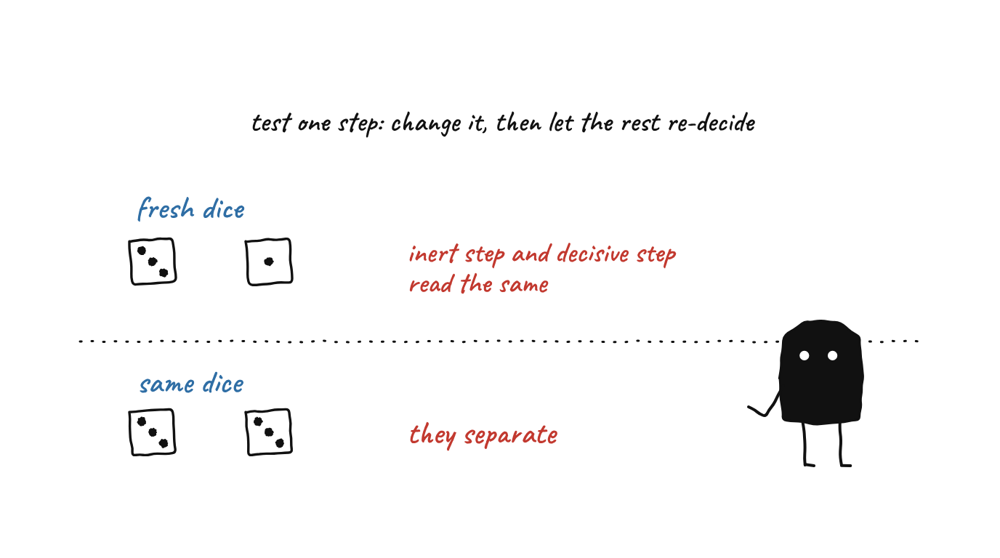
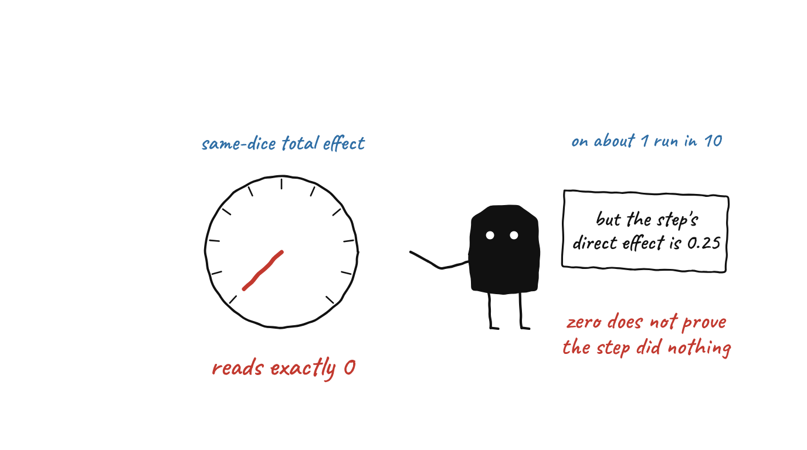
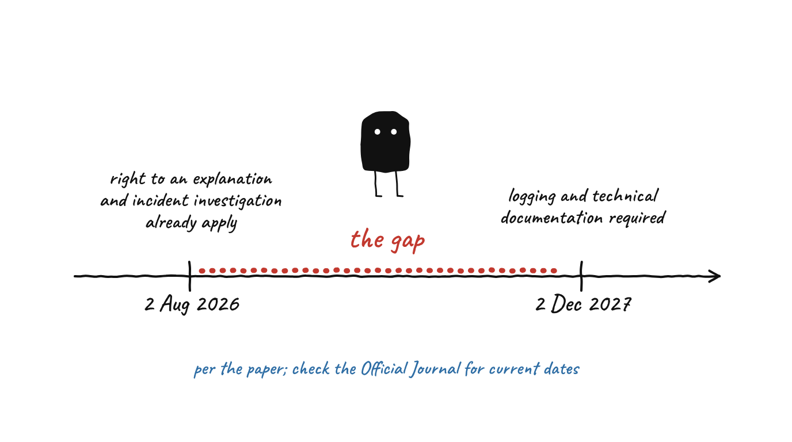

# Causal Attribution for Agentic Decisions

[](https://github.com/designer-coderajay/p2-agentic-attribution/actions/workflows/ci.yml)

Estimators, coupling, and a traceability specification for post-hoc causal
attribution over LLM-agent trajectories, read against Regulation (EU) 2024/1689.

The badge is not decoration. Green means a clean Ubuntu checkout installed the
pinned environment, ran the unit and contract tests and the full validator suite,
confirmed `results/` was byte-identical after re-running it, built the manuscript
and the double-blind variant from source, and re-derived every artifact-backed
number in the paper from its artifact. That is the evidence for the
reproducibility claim the paper makes, as against reproducibility on one laptop.

**Paper:** `paper/main.tex`. Build with `make -C paper`.
**Status:** preprint. The empirical study is pre-registered and **not run**; see
*What this repository does not contain* below.

---

## The idea in one look

<p align="center">
  <br>
  <sub><b>Fresh dice or the same dice.</b> Test a step by changing it and letting the rest re-decide. With fresh noise the inert and the decisive step read the same; with the same noise they separate.</sub>
</p>

<p align="center">
  <br>
  <sub><b>Our own fix has a failure mode.</b> On about one run in ten the same-dice reading for the decisive step is exactly zero, although its direct effect is 0.25.</sub>
</p>

<p align="center">
  <br>
  <sub><b>The Act's calendar opens a gap</b>, as stated in the paper. Check the Official Journal for current dates.</sub>
</p>

### The study as one bench

<p align="center">
  
</p>

| On the bench | In the study | Where to look |
|---|---|---|
| The rail of four pads (start, A, B, outcome) | A planted synthetic agent chain with a known causal structure: A is causally inert, B is decisive | [`src/p2/scm.py`](src/p2/scm.py) |
| The plunger | An intervention on one step | [`src/p2/effects.py`](src/p2/effects.py) |
| The fresh die | Downstream steps re-decide under fresh noise: the marginal total effect of prior work | `TE_marg` in `effects.py` |
| The same die | Downstream steps re-decide under the factual noise: the common-random-numbers total effect | `TE_crn` in `effects.py`, [`src/p2/coupling.py`](src/p2/coupling.py) |
| Dial "marginal" and dial "same dice" | The two total effects, read for each step | [`docs/DERIVATIONS.md`](docs/DERIVATIONS.md) sections 2 and 3 |
| Dial "direct" | The direct effect: downstream actions pinned to the factual ones | `DE` in `effects.py` |
| The "exact 0" lamp | The failure mode of the common-random-numbers estimator | [`scripts/validate_crn_degeneracy.py`](scripts/validate_crn_degeneracy.py) |

Open [`docs/anatomy/estimator-bench-light.html`](docs/anatomy/estimator-bench-light.html) in a browser to scrub through it (details in [`docs/anatomy/README.md`](docs/anatomy/README.md)). The direct effect, the exact zero and the contrast between the dials are from the paper; the needle heights for the marginal and same-dice readings and the dice faces are drawn for the picture, and the whole model is synthetic.

### Step by step

| Step | What happens | Where |
|---|---|---|
| **1. Plant a known answer** | Build a synthetic agent chain whose causal structure is derived by hand, so the right answer is known before any estimator runs. | `src/p2/scm.py`, `docs/DERIVATIONS.md` |
| **2. Make the noise reusable** | Every random draw is a pure function of (seed, step, replicate), never of call order. That is what makes common random numbers possible. | `src/p2/scm.py` |
| **3. Estimate effects per step** | The marginal and common-random-numbers total effects, the direct effect, and the mediated effect (their difference). | `src/p2/effects.py`, `src/p2/mediation.py` |
| **4. Couple across divergent contexts** | Maximal coupling has a closed form, `1 - TV`, and a cost; the order-dependent alternatives do not agree with it. | `src/p2/coupling.py` |
| **5. Read what a trace would say** | Attributors that use only fields a real observability trace carries are compared with what intervention shows. | `src/p2/observability.py`, `src/p2/ranking.py` |
| **6. Check against closed forms** | Each validator asserts against a hand derivation or an exact closed form, never against another estimator. | `scripts/validate_*.py` |
| **7. Verify everything** | `verify.sh` runs the validators, the citation check, the tests and the manuscript number audit, and prints `ALL GREEN` or fails. | `verify.sh`, CI |

---

## What the paper argues

A provider of a high-risk AI system must keep records that make a decision
traceable. For an agentic system it has never been established what those records
must contain for post-hoc causal attribution to be possible at all. This paper
gives the estimator framework, then the conditions under which it fails.

1. **Two total effects, and the distinction is not a variance question.** The
   marginal total effect that prior work measures assigns a causally inert step
   and the decisive one the *identical* value on every run of our planted chain.
   That is an identity, proved, not a near miss.
2. **Our own fix has a failure mode, and it is in the abstract.** The
   common-random-numbers total effect separates them, but returns *exactly zero*
   for the decisive step on about one run in ten, where its direct effect is
   0.25 and it demonstrably acts. An exact zero does not certify that a step did
   nothing.
3. **Coupling across divergent contexts has a closed form and a cost.** Maximal
   coupling agrees at 1 - TV and is the only quantity in the section invariant to
   vocabulary size and source entropy; the order-dependent alternatives move by a
   factor of 142 across a realistic range.
4. **A pre-registered statistic of ours ranked on a quantity the mediation
   literature says not to compute.** Under suppression the mediated share exceeds
   one and ranks a suppressed component above a pure mediator.
5. **The Act's calendar opens a gap.** Article 86's individual right to an
   explanation and Article 73(6)'s duty to investigate the causes of a serious
   incident have applied since 2 August 2026. The Article 12 logging and Annex IV
   documentation that could evidence either were deferred by Regulation (EU)
   2026/1744 to 2 December 2027.

---

## Reproducing every number

```bash
python3 -m pip install -r requirements-dev.txt
bash verify.sh
```

`verify.sh` is the single command that answers *is this repository currently
correct*. It runs every validator, the citation-coverage check, the import
surface, the unit and contract tests, and the manuscript number audit. It prints
`ALL GREEN` or it fails.

Each validator asserts against a **hand derivation or an exact closed form**,
never against another estimator's output. An attribution method validated only
against itself is not validated. The derivations are in `docs/DERIVATIONS.md`.

The environment is pinned rather than floored (`numpy==1.26.4`), because
"reproducible from a pinned environment" is a claim the paper makes. Every file
in `results/` records the python and numpy that produced it and a hash over them.

The same command runs in CI on every push to `main`, from a checkout with nothing
cached, in `.github/workflows/ci.yml`. A second job installs TeX Live and builds
both PDF variants, because `latexmk` is not installed on the machine of record and
an unresolved citation renders as a bracketed question mark that is easy to miss
in a twenty-three page document.

### Building the manuscript

```bash
make -C paper          # main.pdf
make -C paper anon     # anon.pdf, the double-blind variant, from the same source
make -C paper audit    # every artifact-backed number against its artifact
make -C paper check    # fails on any unresolved reference or citation
make -C paper figures  # regenerate the two figures, and check they are not Type 3
make -C paper arxiv    # the submission tarball, test-compiled the way arXiv compiles it
```

`make -C paper arxiv` writes `paper/p2-arxiv-submission.tar.gz` containing
`main.tex`, `main.bbl` and the two figure PDFs, and nothing else. arXiv does not
run bibtex, so the `.bbl` ships with the source; the recipe builds in a scratch
directory, compiles the package with three `pdflatex` passes and no bibtex, fails
if anything is unresolved, and asserts the shipped `main.tex` is byte-identical
to `paper/main.tex`. `docs/ARXIV-SUBMISSION.md` holds the form metadata.

Figure regeneration needs `requirements-paper.txt`, which pins matplotlib
separately because `paper/figures/*.pdf` are committed artifacts that appear in
the manuscript. Regenerated PDFs will not be byte-identical, because matplotlib
stamps a creation date; the rendered content and the embedded font program are
what must match.

The anonymous variant is built from the same `main.tex` behind a `\anon` flag, so
the two cannot drift, and `scripts/check_anonymous.py` fails the build if the
author is identified anywhere before the References heading.

---

## Layout

| path | what is in it |
|---|---|
| `src/p2/` | library code: SCMs, effect estimators, coupling, mediation, observability attributors, ranking |
| `scripts/` | entry points. Each takes no arguments, pins its seed, and writes to `results/` |
| `results/` | committed artifacts. Every number in the paper traces to one |
| `tests/` | unit tests, plus `test_contracts.py`, which asserts the pre-registration is actually reached by the analysis |
| `preregistration/PREREG.md` | the locked analysis plan, committed before the pooled analysis |
| `paper/` | manuscript, bibliography, figure generation |
| `docs/` | derivations, the citation ledger, the regulatory basis, working notes |
| `docs/sources/` | verbatim primary text of instruments the paper quotes, so a quotation can be checked without refetching |
| `RESEARCH_LOG.md` | dated, append-only. What was run and what was learned |

---

## The two documents that carry the discipline

**`docs/CITATION-LEDGER.md`** is append-only and every bibliography entry has a
row in it with a checked date and a source URL. Nothing is cited from
recollection. Corrections are appended as new rows, never edited in place. Four
corrections were made on 5 September 2026, including one field that asserted an
affiliation the primary record does not carry.

**`docs/REGULATORY-BASIS.md`** holds the verbatim text of every provision the
paper relies on, each marked `VERIFIED`, `RECALLED` or `INFERRED`, with the
retrieval date and source. Legal argument in the paper is traceable to a quoted
provision here, and where a provision was *not* retrieved, that is recorded too.

---

## What this repository does not contain

**The empirical study was not run.** It needed a live regulated agent pipeline
that was not available in the study window. The pre-registration is published in
full instead of a result, and the paper reports no rank correlation as a finding.
Everything in `results/` comes from synthetic structural models with planted,
analytically known causal structure. `results/dry_run.json` is flagged
`SYNTHETIC_NOT_RESULTS` in the file itself.

Two provisions bearing on the legal argument were not retrieved and are named in
the paper's Limitations rather than left implied: Articles 40 and 41 with the
associated standardisation request, where log content may actually be specified,
and the GDPR interaction raised by Article 86(3).

---

## Things that went wrong, kept on the record

The research log is append-only and the errors stay in it. A partial list, kept
here because a repository that shows only its successes is not evidence of
anything:

- A cell in the manuscript's Appendix B table read `0.0446` where the committed
  artifact said `0.1655`. It survived a citation sweep, a figure pass, two
  adversarial reviews and four readings. `scripts/audit_paper_numbers.py` now
  derives every artifact-backed cell from its artifact and fails the build on
  disagreement.
- A session of this project reported that `scripts/validate_primary.py` had
  been broken for two weeks. It had not. The analysis ran against a copy of
  the repository cached sixteen days earlier, and three checks agreed with
  each other because all three read the same stale file. Retracted in
  `RESEARCH_LOG.md`. A cached copy is an artifact, and an artifact is not
  the source of record.
- An earlier draft claimed shared-`u` coupling attains the maximal-coupling
  bound. It does not, and `scripts/validate_coupling.py` rejected it at up to
  215 standard errors before it reached the manuscript.
- The paper's requirement to fix the vocabulary order in the sampler was stated
  backwards: probability sorting is not uniformly worse than a fixed index order.
- Article 86 was retrieved verbatim into `docs/REGULATORY-BASIS.md` in August,
  described there as the sharpest point in the regulatory analysis, and appeared
  zero times in the manuscript until 5 September.
- A draft of Section 8 quoted Commission Implementing Decision C(2023) 3215 as
  the operative standardisation request. It had been **repealed** in June 2025 by
  C(2025) 3871, and had been drafted against the AI Act *proposal* rather than
  the adopted Regulation. The document itself does not say it is repealed; the
  Commission's eNorm register does. A legal instrument retrieved from a search
  result has a status that the instrument's own text does not state.
  `scripts/validate_standardisation_request.py` now pins the manuscript's
  quotation to the committed primary text and fails if the paper names the
  repealed instrument without saying so.
- The same draft reported a "median of 115" across the ten deliverables of that
  annex. It was the sixth value of a ten-element sorted list. The correct median
  was 112, and the comparison has been removed rather than corrected, because
  under the 2025 request the same formulaic sentence appears at five other
  points and length carries nothing.

---

## Companion work

This is the second of three papers asking whether the evidence used to certify an
AI system as explainable survives the conditions under which it must be relied
on. The first, on circuit-level interpretability evidence, is
[arXiv:2608.13754](https://arxiv.org/abs/2608.13754).

## Licence

MIT. See `LICENSE`.
